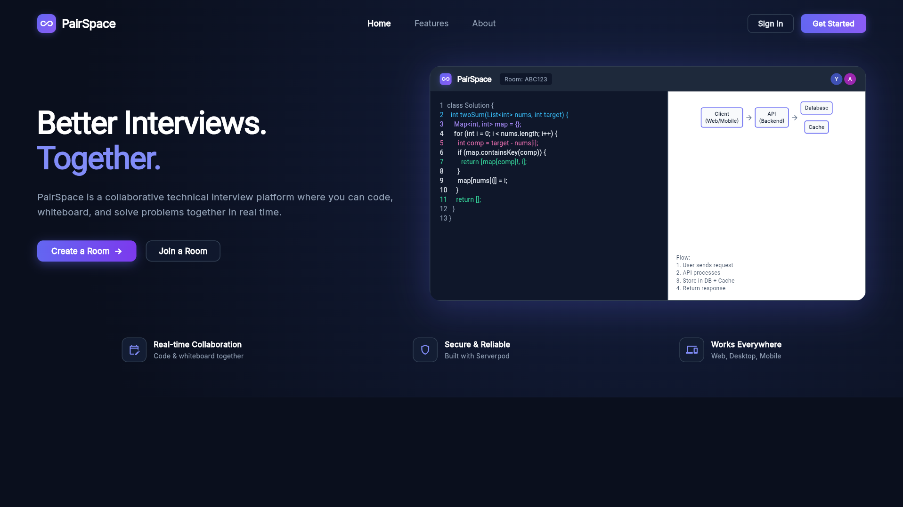
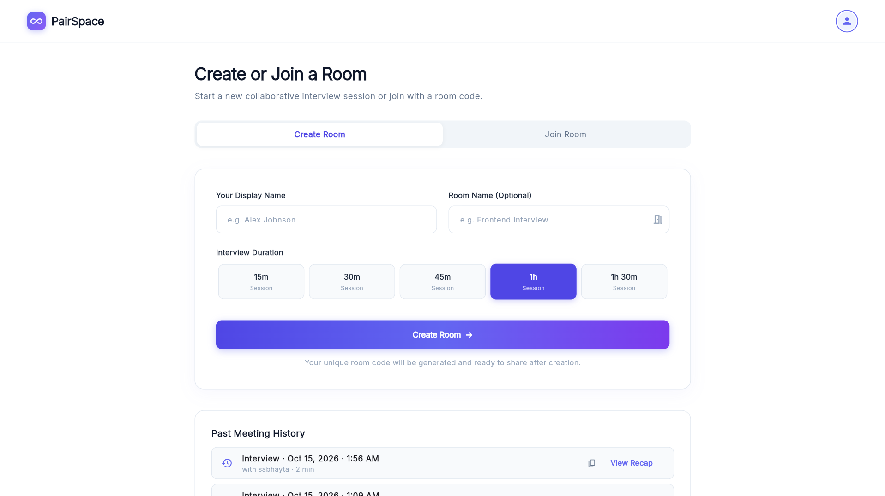
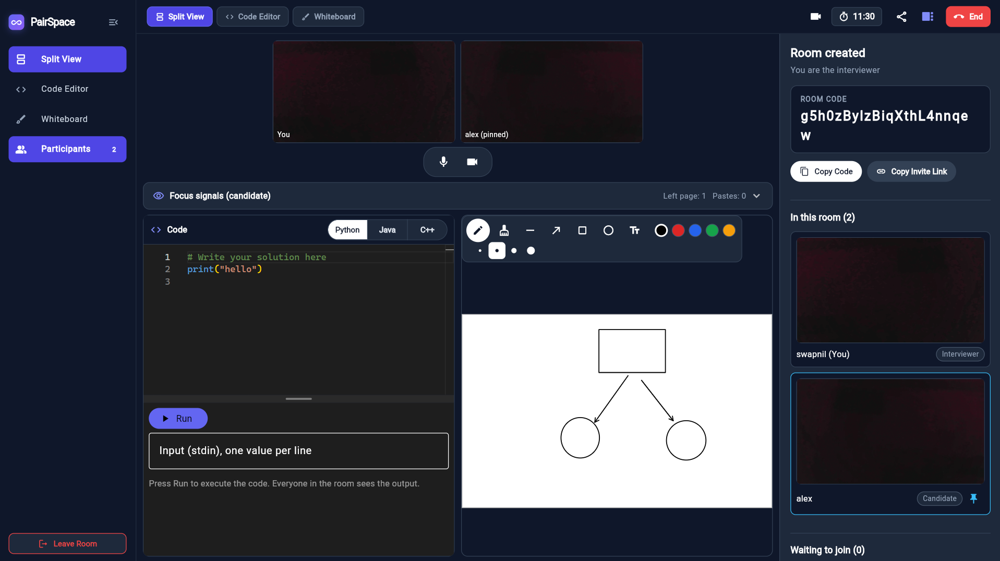
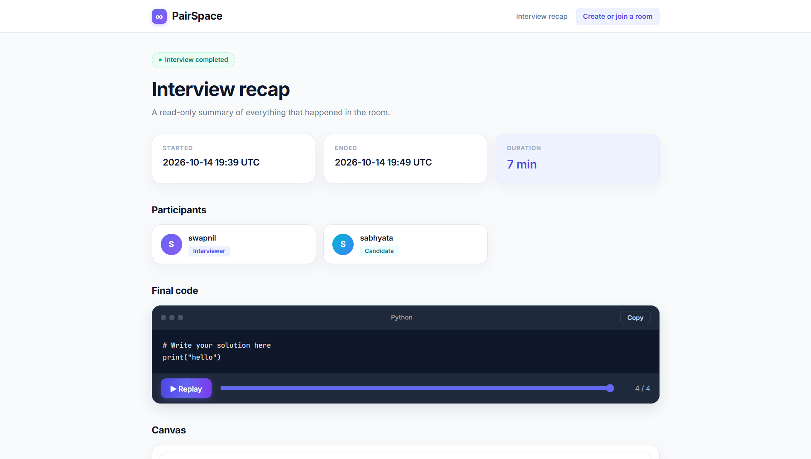
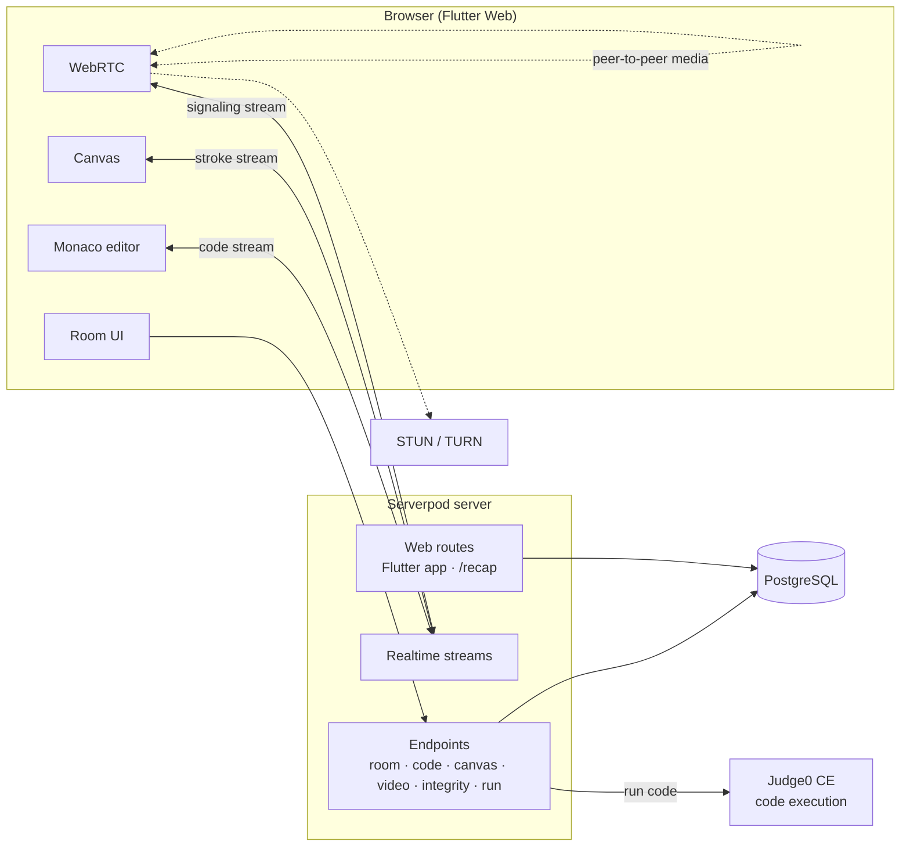

<div align="center">

# ∞ PairSpace

### The live pair-interview room. Code, draw, talk, and get a recap you can trust.

### 🌐 Live demo: [pairspace.serverpod.space](https://pairspace.serverpod.space)

> **Note:** email verification codes may arrive in your **Spam** folder. Check there, or sign in with Google.

<br>


<br>

[Features](#-features) · [How it works](#-how-it-works) · [Quick start](#-quick-start) · [Architecture](#-architecture) · [Security](#-security-and-privacy) · [Deploy](#-deployment) · [Limitations](#-honest-limitations)

</div>
## 📸 Screenshots

<p align="center">
  
  
  
  
</p>

---

## Why PairSpace

Remote technical interviews are stitched together from five tabs: a video call, a shared doc, a whiteboard, an online compiler, and a notes app. Candidates lose focus, interviewers lose context, and afterwards nobody has a reliable record of what actually happened.

**PairSpace puts the whole interview in one room, then hands the interviewer a private recap page** with the final code, a replay of how it was written, the drawing, the participants, and the integrity signals.

No installs for the candidate. One link, one browser tab.

---

## ✨ Features

<table>
<tr>
<td width="50%" valign="top">

### 🧑‍💻 Collaborative code editor
Monaco (the VS Code editor) shared live between both people. Choose **Python, Java or C++**, get language-aware starter code, and hit **Run** to execute it in a sandbox. Optional stdin is supported, and output streams to both participants at once.

</td>
<td width="50%" valign="top">

### 🎨 Shared whiteboard
A real-time canvas for system design and diagrams. Every stroke is synced and stored, so it can be **replayed** on the recap page exactly as it was drawn.

</td>
</tr>
<tr>
<td valign="top">

### 📹 Live video
Peer-to-peer **WebRTC** video and audio with signaling over Serverpod streams. Mic and camera controls, and a video strip you can hide to get more room for the work.

</td>
<td valign="top">

### 🚪 Admission lobby
Candidates wait in a lobby until the interviewer **admits or denies** them. Presence is tracked live, and rooms close automatically when the interviewer disappears.

</td>
</tr>
<tr>
<td valign="top">

### ⏱️ Fair, server-synced timer
The countdown starts when the candidate is admitted and uses the **server clock**, so both sides see the same time even if their device clocks disagree.

</td>
<td valign="top">

### 🛡️ Transparent integrity monitoring
Candidates see a clear consent prompt and a persistent banner. Tab switches, window blur and pastes (with size) are logged for the interviewer, with a caveat that these are signals, not proof.

</td>
</tr>
<tr>
<td colspan="2" valign="top">

### 📄 Private recap page
A server-rendered, **token-gated** page at `/recap/{code}?k={token}` showing the outcome, timeline, participants, final code, **code replay**, **canvas replay**, and a focus/paste summary. Times are shown in the **viewer's local time zone**, and the page is `noindex` and sends no referrer.

</td>
</tr>
</table>

---

## 🎬 How it works

```text
 Interviewer                                        Candidate
 ───────────                                        ─────────
 1. Sign in (email or Google)
 2. Create room, choose duration
 3. Copy invite link  ───────────────────────────►  4. Open link, sign in, enter name
                                                    5. Wait in lobby
 6. Admit candidate   ◄───────────────────────────
 7. Timer starts, video connects
 8. Code together · Draw together · Run code
    Integrity signals recorded (with consent)
 9. End interview
10. Open private recap  → code, replays, signals
```

**Try it in two minutes:** open the app in a normal window (interviewer) and an incognito window (candidate), create a room in one, paste the invite link into the other, admit, and start typing.

---

## 🚀 Quick start

### Prerequisites

| Tool | Version |
|---|---|
| Flutter | 3.44+ |
| Dart | 3.12.2+ |
| Serverpod CLI | matching Serverpod 4.0.3 |
| Docker | optional, for Postgres and Redis via `docker compose` |

```bash
dart pub global activate serverpod_cli
```

### 1. Clone and install

```bash
git clone https://github.com/SabhyataC/pairspace.git
cd pairspace
dart pub get
```

### 2. Configure secrets

Server secrets live in `pairspace_server/config/passwords.yaml` (never committed). Add your Google OAuth client secret there if you want Google sign-in, and set the matching client ID in `pairspace_flutter/lib/client.dart`. Email sign-in works without it.

Optional, for video behind strict networks, add TURN credentials under the same file:

```yaml
development:
  turnUrls: 'turn:your-turn-host:3478'
  turnUsername: 'user'
  turnCredential: 'secret'
```

## 🚀 Run it locally

Everything runs on your own machine: database, server, web app. Plan on **10 to 15 minutes** the first time, most of it waiting for downloads and the first build.

### What you need

| Tool | Version | Check it |
|---|---|---|
| **Flutter** (includes Dart) | 3.44 or newer | `flutter --version` |
| **Dart** | 3.12.2 or newer | `dart --version` |
| **Serverpod CLI** | 4.0.x | `serverpod --version` |
| **Chrome** (or Edge or Firefox) | recent | needed for camera and microphone |
| **Internet access** | | code execution uses the public Judge0 service |

You do **not** need to install PostgreSQL or Docker. In development, Serverpod starts an embedded PostgreSQL database for you.

Install the Serverpod CLI if you don't have it:

```bash
dart pub global activate serverpod_cli
```

> [!TIP]
> Run `flutter doctor` once. If it reports no issues for Chrome and Dart, you are ready.

---

### Step 1. Get the code

```bash
git clone https://github.com/SabhyataC/pairspace.git
cd pairspace
dart pub get
```

---

### Step 2. Create the secrets file

Secrets are never committed, so you create `pairspace_server/config/passwords.yaml` yourself from the template.

**Windows (PowerShell)**
```powershell
cd pairspace_server
copy config\passwords.example.yaml config\passwords.yaml
```

**macOS / Linux**
```bash
cd pairspace_server
cp config/passwords.example.yaml config/passwords.yaml
```

Open `config/passwords.yaml` and replace every `CHANGE_ME` with a long random string. To generate one:

**Windows (PowerShell)**
```powershell
[Convert]::ToBase64String((1..48 | ForEach-Object { Get-Random -Maximum 256 }))
```

**macOS / Linux**
```bash
openssl rand -base64 48
```

Run it once per value, so each secret is different.

| Key | What it is |
|---|---|
| `database` | password for the local database |
| `serviceSecret` | internal server secret |
| `jwtHmacSha512PrivateKey` | signs login tokens |
| `jwtRefreshTokenHashPepper` | protects refresh tokens |

**Google sign-in is optional.** Email sign-up works without it. To enable Google, add your OAuth client secret as `googleClientSecret` in the same file and put the matching client ID in `pairspace_flutter/lib/client.dart`.

---

### Step 3. Database

There is nothing to install and no command to run.

The first time you start the server (Step 5), Serverpod:

1. starts the embedded PostgreSQL database (data is kept in `pairspace_server/.serverpod/`),
2. creates the `pairspace` database,
3. applies every migration in `pairspace_server/migrations/`, which builds all the tables.

> [!NOTE]
> The database listens on port **5432**. If you already run PostgreSQL on that port, stop it first, or the server will not start.

**To reset the database to empty**, stop the server and delete the data folder:

```powershell
rmdir /S /Q .serverpod
```
```bash
rm -rf .serverpod
```

The next start recreates it from scratch.

---

### Step 4. Build the web app

The Flutter web build is served by the Serverpod web server and is not committed, so build it once. From `pairspace_server`:

```bash
serverpod run flutter_build
```

This builds `pairspace_flutter` and copies the result into `pairspace_server/web/app`. The first build takes a few minutes. Re-run it after any change to the Flutter code.

---

### Step 5. Start the server

Still in `pairspace_server`:

```bash
serverpod start --no-flutter
```

Wait until the console shows the server running. Then open:

### 👉 http://localhost:8082

| Service | URL |
|---|---|
| **The app** and recap pages | http://localhost:8082 |
| API server | http://localhost:8080 |
| Insights | http://localhost:8081 |

Press `Q` in the terminal to stop the server.

> [!NOTE]
> `serverpod start` may also open a development copy of the Flutter app. Use the one at **http://localhost:8082**.

---

### Step 6. First sign-in

1. Click **Create or join a room** and choose **Sign up with email**.
2. Enter an email and password.
3. **The verification code appears in the server terminal**, not in your inbox. In development, Serverpod prints codes to the console instead of sending email. Copy the code into the app.
4. You are in. Enter a display name and create a room.

---

### Step 7. Try a full interview on one machine

You need two accounts, so use two windows:

| Window | Role |
|---|---|
| Normal Chrome window | **Interviewer**: creates the room |
| Incognito window of the same browser | **Candidate**: joins with the invite link |

1. In the normal window, create a room and click the **share icon** to copy the invite link.
2. In the incognito window, paste the link, sign up with a second email (the code is in the terminal again), and enter a name.
3. Back in the interviewer window, click **Admit** on the candidate.
4. Write code, press **Run**, draw on the whiteboard, and check the video tiles.
5. Click **End interview**, then open the **recap** from the past meetings list.

> [!TIP]
> Allow camera and microphone when the browser asks. Two windows of the **same browser** can usually share one webcam. Two different browsers often cannot.

---

### Troubleshooting

| Problem | Fix |
|---|---|
| Server stops with a missing password error | The error names the key. Add it to `config/passwords.yaml`. |
| Server fails to start with a port error | Something is already using 5432, 8080, 8081 or 8082. Stop it, or stop your own PostgreSQL. |
| `http://localhost:8082` shows "build the Flutter app" | Run `serverpod run flutter_build` and refresh. |
| You changed Flutter code and see no change | Re-run `serverpod run flutter_build`, then hard-refresh with `Ctrl+Shift+R`. |
| No verification email arrives | It never will in development. Read the code in the server terminal. |
| You changed a model (`*.spy.yaml`) | Run `serverpod generate` and `serverpod create-migration`, then restart the server. |
| Database looks wrong or out of date | Stop the server, delete `pairspace_server/.serverpod`, and start again. |
| **Run** says the service is unavailable | Judge0 needs internet and has shared limits. Wait a few seconds and retry. |
| Camera or microphone is blocked | Click the lock icon in the address bar and allow both. |
| Candidate sees video as black | Both people need camera permission. Check that no other app is using the webcam. |

---

### Optional: TURN server for video on strict networks

Video works on most networks with the built-in STUN server. For reliability behind firewalls, add TURN credentials to `config/passwords.yaml`:

```yaml
development:
  turnUrls: 'turn:your-turn-host:3478'
  turnUsername: 'user'
  turnCredential: 'secret'
```

## 🏗️ Architecture



### Tech stack

| Layer | Technology |
|---|---|
| Frontend | Flutter Web, `flutter_monaco`, `flutter_webrtc`, `package:web` |
| Backend | Serverpod 4.0.3 (Dart), typed endpoints and streams |
| Auth | Serverpod auth: email and Google, JWT tokens |
| Database | PostgreSQL with Serverpod migrations |
| Realtime | Serverpod streaming messages |
| Video | WebRTC with Serverpod signaling, STUN, optional TURN |
| Code execution | Judge0 CE (Python, Java, C++) |
| Recap | Serverpod `WidgetRoute` with Mustache templates |

### Repository layout

```text
pairspace/
├── pairspace_server/      Serverpod backend
│   ├── lib/src/
│   │   ├── rooms/         create, join, admit, timing, lifecycle
│   │   ├── code/          shared editor stream, run endpoint, edit recorder
│   │   ├── canvas/        whiteboard stroke stream
│   │   ├── video/         WebRTC signaling
│   │   ├── integrity/     focus and paste event log
│   │   ├── web/routes/    token-gated recap route
│   │   └── models/        .spy.yaml data models
│   ├── web/templates/     recap.html
│   ├── migrations/        database migrations
│   └── Dockerfile
├── pairspace_flutter/     Flutter Web client
│   └── lib/screens/       landing, room, editor, canvas, video, integrity
└── pairspace_client/      generated client (do not edit)
```

---

## 🔐 Security and privacy

PairSpace treats every realtime channel as untrusted input.

| Area | Protection |
|---|---|
| **Authentication** | Every endpoint requires login. Participants can only act inside rooms they belong to. |
| **Admission** | Streams re-check that the participant is still admitted every **5 seconds**, so a denied or removed user is cut off mid-session. |
| **Rate limits** | Canvas **60/s**, code **40/s**, signaling **100/s** per stream. Code runs are limited to **5 per 30 seconds** per user. |
| **Size caps** | Code updates 100,000 chars, runnable code 20,000, stdin 5,000, SDP 20,000, ICE candidate 2,000, integrity events 2,000 per participant. |
| **Role checks** | Only the interviewer can admit, deny, end the room, or open the recap. |
| **Recap access** | Random per-room token, constant-time comparison, wrong key looks like a 404, `noindex`, and `no-referrer`. |
| **Ended rooms** | Streams and actions are refused once the room has ended. |
| **Consent** | Integrity monitoring is disclosed with a consent dialog and a visible banner. Declining leaves the room. |

**Privacy by design:** paste events record only the **length** of pasted text, never its content.

---
## 🌍 Deployment

### 🌐 Live demo: [pairspace.serverpod.space](https://pairspace.serverpod.space)

PairSpace is deployed on [Serverpod Cloud](https://serverpod.dev/cloud), which provides managed PostgreSQL, HTTPS, and hosting for the Flutter web app.

### Deploy to Serverpod Cloud

1. **Set the Google redirect URI** in `pairspace_flutter/lib/client.dart` to your public URL (`https://<project-id>.serverpod.space/auth/callback`) and add the same URL to your Google OAuth client. This is compiled into the web build, so set it before deploying.
2. **Add production secrets.** List what Cloud already manages, then set the rest:
```bash
   serverpod cloud password list
   serverpod cloud password set googleClientSecret --from-file google_secret.json
```
   `googleClientSecret` must be the OAuth client JSON with a top-level `"web"` object. Use `--from-file` so the quotes are not mangled. Never commit this file.
3. **First launch** (from `pairspace_server`):
```bash
   serverpod cloud launch
```
4. **Later updates:**
```bash
   serverpod cloud deploy
```

Optional TURN for video on strict networks:
```bash
serverpod cloud password set turnUrls "turn:your-turn-host:3478"
serverpod cloud password set turnUsername "user"
serverpod cloud password set turnCredential "secret"
```

### Self-hosting with Docker

The server also ships a multi-stage `Dockerfile`. Run `serverpod run flutter_build` first, then build from the repository root:
```bash
docker build -f pairspace_server/Dockerfile .
```
You then need your own PostgreSQL, HTTPS, public hosts in `config/production.yaml`, and production secrets (`config/passwords.yaml` or `SERVERPOD_PASSWORD_*` variables). Browsers require HTTPS for camera, microphone and clipboard access.

---.

---


## 🗺️ Roadmap

- [ ] Interviewer private notes saved with the recap
- [ ] Run history on the recap page
- [ ] Question bank pushed to the shared view
- [ ] Kick or demote a participant mid-session
- [ ] Recap link rotation
- [ ] Scheduling and email invites

---


## 🙏 Built on

[Serverpod](https://serverpod.dev) · [Flutter](https://flutter.dev) · [Monaco Editor](https://microsoft.github.io/monaco-editor/) · [WebRTC](https://webrtc.org) · [Judge0](https://judge0.com) · [PostgreSQL](https://www.postgresql.org)

<div align="center">

<br>

**PairSpace**: interview in one room, remember it in one page.

</div>